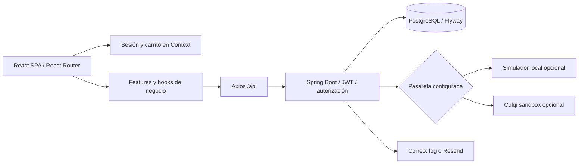

# Entregable 2 — implementación y revisión

## Fuentes y alcance

Requisitos funcionales: `Historias_Usuario_ShopifyClone.xlsx`, con HU-01 a HU-13. Requisitos del entregable: `Shopify Clone.docx.PDF`, páginas 1–2. Se trataron como requisitos del producto solicitado; no como autorización para acciones externas. La marca del proyecto es Bodeko; el nombre que aparece en el encabezado del Excel pertenece únicamente a la plantilla.

El PDF permite checkout simulado en el Entregable 2, pero exige consumo real de la API para la aplicación. La implementación conserva ese límite: pagos opcionalmente simulados; usuarios, tiendas, categorías, productos, existencias, carrito y órdenes en Spring/PostgreSQL reales. No hay base de datos de demostración dentro del bundle ni fallback silencioso a datos quemados cuando falla la API.

## Matriz de funcionalidades

| Historia                      | Feature                           | Implementación / límite                                                                                                                                                                                                                               |
| ----------------------------- | --------------------------------- | ----------------------------------------------------------------------------------------------------------------------------------------------------------------------------------------------------------------------------------------------------- |
| HU-01 Registro                | `auth`                            | Alta cliente y propietario, confirmación de contraseña, correo único, teléfono y documento opcional de cliente. Login automático con JWT devuelto por la API.                                                                                         |
| HU-02 Sesión y roles          | `auth`, `context`, `core/layouts` | Login/logout, restauración mediante `/auth/me`, JWT en cabecera, guards ADMIN/CUSTOMER, manejo de 401/403.                                                                                                                                            |
| HU-03 Tiendas                 | `stores`                          | Crear tienda, listado del propietario, RUC/subdominio, PEN/IGV por defecto, configuración de IGV. Directorio y resolución pública añadidos.                                                                                                           |
| HU-04 Categorías              | `categories`                      | Crear/editar/eliminar con confirmación, duplicados e impedimento de borrar categorías con productos.                                                                                                                                                  |
| HU-05 Productos               | `products`                        | Crear borrador, editar datos, imagen por URL, categoría, precio, exoneración de IGV, publicar y archivar. El backend no tiene DELETE: se archiva para preservar historial, como indica HU-05.                                                         |
| HU-06 Inventario              | `inventory`                       | Selección de producto, lectura de cantidad/umbral/fecha, edición independiente y alerta de stock bajo del servidor. El registro se crea automáticamente en Spring. No se elimina un inventario independiente de su producto.                          |
| HU-07 Ofertas                 | `offers`                          | Crear precio/rango, validación de fechas, historial y vigencia. La API aplica los precios de oferta al carrito.                                                                                                                                       |
| HU-08 Carrito                 | `cart`, `CartContext`             | Agregar, aumentar, actualizar y quitar; contador global. Persistencia real por cliente/tienda entre sesiones.                                                                                                                                         |
| HU-09 Checkout                | `checkout`                        | Boleta/DNI o factura/RUC/razón social, dirección opcional, confirmación remota y navegación a la orden. Stock, snapshots e IGV se calculan en Spring.                                                                                                 |
| HU-10 Pagos                   | `payments`                        | Token de simulador y adaptador oficial de tokenización sandbox opcional; cobro en el backend, rechazo en español, orden pendiente y confirmación al aprobar. Recarga segura de la orden. No se certificó Culqi sandbox ni se implementó 3DS/webhooks. |
| HU-11 Órdenes admin           | `orders`                          | Lista paginada y filtrada, detalle fiscal/contable, cambios de estado permitidos, confirmación al cancelar, reembolso/restauración en el backend.                                                                                                     |
| HU-12 Catálogo                | `catalog`                         | Público, productos activos, búsqueda, categorías, en-stock, paginación, detalle con enlace directo y ruta por subdominio.                                                                                                                             |
| HU-13 Confirmación/despliegue | `notifications` y documentación   | Confirmación visual verificada contra orden pagada. El envío de email ya existe en Spring y se probó en modo log. Envío real, publicación cloud y video pertenecen al Entregable 3 y siguen pendientes.                                               |

## Ampliación: cuenta del cliente

La feature `customer-orders` incorpora historial multitienda, detalle, pago pendiente y cancelación de órdenes propias, con barra lateral de cuenta inspirada en la referencia del usuario y colores Bodeko. Está protegida por rol CUSTOMER y reutiliza la cancelación transaccional existente. No añade tablas ni migraciones. Ver [MIS_ORDENES.md](MIS_ORDENES.md) para reglas, endpoints, capturas y pruebas nuevas.

## Requisitos transversales del Entregable 2

| Requisito                    | Resultado                                                                                                                                                                   |
| ---------------------------- | --------------------------------------------------------------------------------------------------------------------------------------------------------------------------- |
| React + TypeScript + Vite    | SPA con strict, noUnused y noUncheckedIndexedAccess; build de producción aprobado.                                                                                          |
| React Router público/privado | Catálogo/detalle/acceso públicos; carrito/checkout/pago y cuenta/mis órdenes CUSTOMER; panel ADMIN; selección de tienda del propietario.                                    |
| Context API                  | Sesión, tienda activa y carrito por tienda.                                                                                                                                 |
| Consumo de API real          | Servicios Axios con rutas y DTO del código Java; prueba local con PostgreSQL real.                                                                                          |
| Responsive                   | Catálogo y checkout revisados a 390 px; rejillas y resumen pasan a una columna. Tablas contienen su propio desplazamiento horizontal.                                       |
| Errores y loading visibles   | Consultas con indicador y reintento; mutaciones con bloqueo, Sonner y aviso persistente; códigos del backend traducidos.                                                    |
| Validación de inputs         | Rechazo de caracteres durante edición/pegado, máximos, enteros/importes, correo, documento, teléfono, subdominio y fechas; mensajes junto al campo y ejemplo visible.       |
| Accesibilidad                | Labels, ayudas asociadas, aria-invalid, mensajes alert/status, diálogo nativo con foco/Escape y enlace para saltar al contenido. Sonner también tiene etiquetas en español. |
| Mantenibilidad               | JSDoc en interfaces, tipos, hooks y componentes; funciones/servicios pequeños; barrel por feature y código formateado.                                                      |

## Arquitectura

En desarrollo Vite hace proxy a Spring. En producción prevista, el frontend se compila a `dist` y se sirve en Vercel/Netlify, mientras Spring y PostgreSQL se alojan por separado. `VITE_API_URL` y `FRONTEND_URL` enlazan ambos orígenes. Esta arquitectura de publicación es una propuesta preparada en los archivos de hosting, no un despliegue realizado.

## Evidencias del 10 de noviembre de 2026

- `npm test`: 12 pruebas pasadas (validaciones, mensajes españoles y contratos HTTP).
- `npm run build`: compilación TypeScript y bundle Vite satisfactorios.
- `mvn '-Djava.version=21' test`: prueba existente pasada con PostgreSQL 18 temporal.
- `node tools/verify-api.mjs --disposable`: 55 comprobaciones de respuestas HTTP y aserciones de negocio pasadas contra Spring real y simulador local de pagos.
- Navegador: registro vacío muestra validaciones; un nombre rechaza dígitos; vista móvil revisada; login propietario y panel con información de la API; login cliente, agregar carrito, checkout, rechazo visible en español, aprobación y recuperación de orden pagada al recargar.

Los datos de QA son sintéticos y están en una base aislada creada bajo `frontend/.qa`, excluida de Git. No se modificaron bases existentes. Las capturas son evidencia de pruebas, no datos incluidos en la aplicación. No se verificó la entrega de correo real ni una transacción contra Culqi.

Capturas históricas de la primera revisión, anteriores al cambio de marca a Bodeko: [inicio en escritorio](capturas/inicio-escritorio.png) y [confirmación en móvil](capturas/confirmacion-movil.png).

## Pendientes externos

Para usar el backend del equipo se necesita su URL y configuración de desarrollo. Para usar su simulador se necesita el archivo original y sus tokens/puerto/clave. El simulador local incluido permite la demostración sin esas dependencias.

Para Culqi sandbox hacen falta `pk_test_…` en frontend y `sk_test_…` en backend del mismo comercio/entorno. Para correo real hace falta configurar Resend y remitente; el modo log no entrega correos. Dominio, DNS wildcard, hosting, 3DS/webhooks y video de demostración no se presentaron como terminados.
